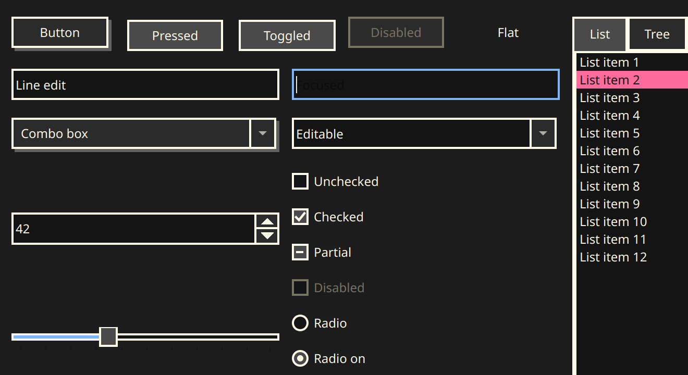
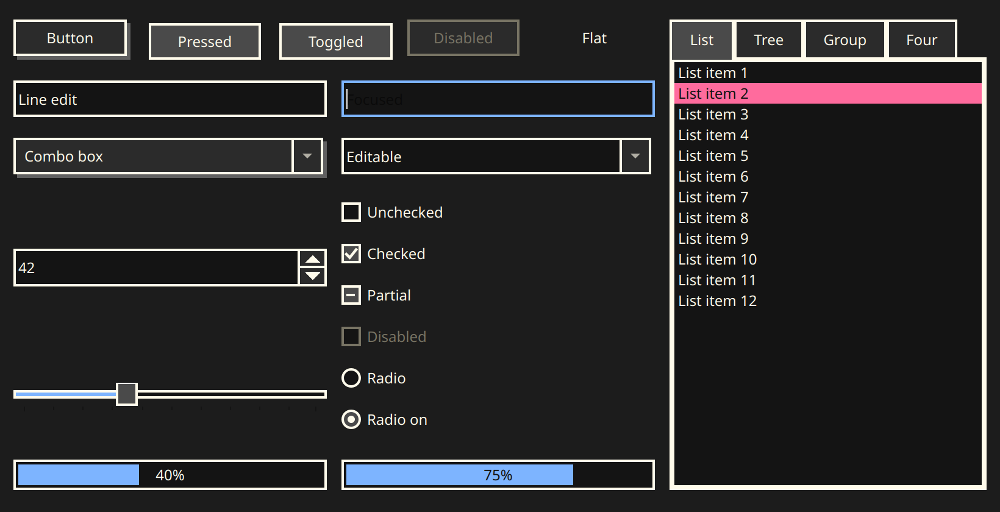
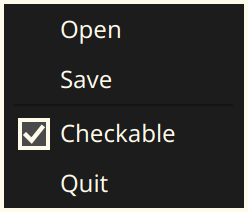
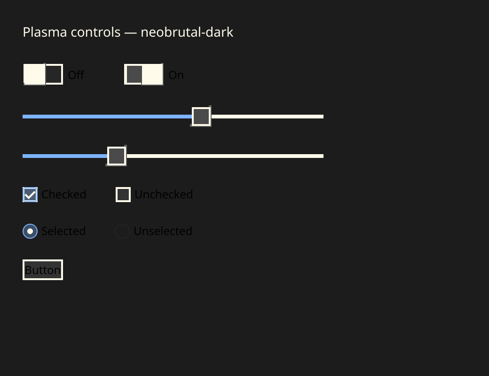

# Neobrutal Dark untuk KDE Plasma 6

Tema gelap bergaya **neobrutalism** untuk KDE Plasma 6: outline tebal warna krem, tombol timbul
dengan *hard shadow*, aksen abu medium / krem / pink / biru, dan tanpa sudut membulat sama sekali.

Tema ini dipasang sebagai tema **baru** bernama **"Neobrutal Dark"** — tidak menimpa tema yang
sudah ada. Selain color scheme dan Plasma Style, repo ini berisi **Application Style** dan
**Window Decoration** buatan sendiri yang ditulis dalam C++ (bukan Kvantum, bukan Aurorae).

[](https://github.com/naufalalamsyah453/neobrutal-dark-kde/releases)
[](LICENSE)
[](https://kde.org/plasma-desktop/)



## Sorotan

- **Application Style "Neobrutal"** — turunan Fusion (`QProxyStyle`) yang menggambar ulang tombol,
  line edit, combobox, spinbox, checkbox, radio, slider, scrollbar, progress bar, tab, header,
  tooltip, menu, dan seleksi list. Hover memunculkan shadow pink, tombol ditekan bergeser dan
  berisi abu medium.
- **Window Decoration "Neobrutal Dark"** — plugin KDecoration3: bingkai krem 3px, titlebar abu
  gelap, tombol kotak berwarna (hijau minimize, biru maximize, pink close), dan hard shadow
  jendela.
- **Plasma Style** — app menu, panel, popup, tooltip, **slider**, dan **switch/toggle** senada
  (termasuk popup tray dan Quick Settings).
- **Color scheme, Konsole, dan Kvantum** (opsional) disertakan.
- Semua warna aksen dibaca dari color scheme aktif (`kdeglobals`), jadi tema ikut berubah bila
  skema warnanya diganti.

| Application Style | Menu & popup |
| --- | --- |
|  |  |

Kontrol Plasma (slider, switch, checkbox, radio):



## Isi Repo

| Path | Keterangan |
| --- | --- |
| `color-schemes/NeobrutalDark.colors` | Color scheme Plasma/KDE |
| `style/` | Application Style (plugin Qt6 C++), nama **"Neobrutal"** |
| `decoration/` | Window Decoration (plugin KDecoration3 C++), nama **"Neobrutal Dark"** |
| `plasma/desktoptheme/neobrutal-dark/` | Plasma Style (panel, popup, tooltip, app menu) |
| `konsole/NeobrutalDark.colorscheme` | Skema warna Konsole |
| `Kvantum/NeobrutalDark/` | Tema Kvantum lama, opsional (style baru tidak membutuhkannya) |
| `tools/preview.cpp` | Render galeri widget ke PNG (`-DBUILD_PREVIEW=ON`) |
| `install.sh` / `uninstall.sh` | Pemasang dan penghapus tema |

## Kebutuhan

- KDE Plasma 6 (diuji dikompilasi terhadap Qt 6.9 / KDecoration3 6.8.80)
- CMake, compiler C++20, dan header pengembangan KDE

Arch Linux:

```bash
sudo pacman -S --needed base-devel cmake extra-cmake-modules \
  qt6-base kcoreaddons kdecoration
```

> Distribusi lain: pasang paket yang setara (`qt6-base-devel`, `kf6-kcoreaddons-devel`,
> `kdecoration-devel`, `extra-cmake-modules`). Nama paket berbeda tiap distro.

## Pasang

```bash
git clone https://github.com/naufalalamsyah453/neobrutal-dark-kde.git
cd neobrutal-dark-kde
chmod +x install.sh uninstall.sh
./install.sh
```

Atau unduh arsip dari halaman [Releases](https://github.com/naufalalamsyah453/neobrutal-dark-kde/releases),
ekstrak, lalu jalankan `./install.sh`.

Opsi `install.sh`:

| Perintah | Efek |
| --- | --- |
| `./install.sh` | Kompilasi style + dekorasi, pasang ke `/usr` (pakai `sudo`) |
| `./install.sh --apply` | Sama seperti di atas, lalu langsung mengaktifkan semuanya |
| `./install.sh --user` | Pasang plugin ke `~/.local` tanpa sudo (perlu logout/login agar `QT_PLUGIN_PATH` terbaca) |
| `./install.sh --no-build` | Hanya memasang file tema (warna, Plasma Style, Konsole, Kvantum) |

## Aktifkan Manual

Buka **System Settings → Colors & Themes**:

1. **Colors** → "Neobrutal Dark"
2. **Plasma Style** → "Neobrutal Dark"
3. **Application Style** → "Neobrutal"
4. **Window Decorations** → "Neobrutal Dark"
5. **Konsole** → Settings → Edit Current Profile → Appearance → "Neobrutal Dark"

Logout lalu login sekali agar semua aplikasi dan KWin memuat plugin baru.

## Build dari Source

```bash
cmake -S . -B build -DCMAKE_BUILD_TYPE=Release
cmake --build build -j"$(nproc)"
sudo cmake --install build          # atau: cmake --install build --prefix ~/.local
```

Untuk merender galeri widget (tanpa memasang apa pun):

```bash
cmake -S . -B build -DBUILD_STYLE=OFF -DBUILD_DECORATION=OFF \
  -DBUILD_PREVIEW=ON
cmake --build build -j"$(nproc)"
QT_QPA_PLATFORM=offscreen ./build/neobrutal-preview preview-style.png
```

## Hapus / Kembali ke Breeze

Pindahkan dulu ke Breeze di System Settings (Colors, Plasma Style, Application Style,
Window Decorations), lalu:

```bash
./uninstall.sh
```

## Catatan & Keterbatasan

- Style sudah dikompilasi dan dirender (offscreen) dengan Qt 6.9, tetapi belum diuji menyeluruh
  di Plasma 6.8 — terutama hover/pressed pada scrollbar, spinbox, dan tab.
- Dekorasi jendela lolos kompilasi terhadap header KDecoration3, tetapi belum dijalankan di KWin.
  Jika tampil aneh, pilih kembali Breeze di Window Decorations dan laporkan bagian yang salah.
- Aurorae tidak dipakai karena di Plasma 6.8 sudah dipisah dari KWin dan tidak selalu terpasang.
- Tidak ada sudut membulat — memang begitu gaya neobrutalism-nya.
- Aplikasi QML/Kirigami (mis. sebagian halaman System Settings) memakai style bawaan Breeze untuk
  kontrol QQC2. Warnanya mengikuti color scheme Neobrutal Dark (latar gelap, teks krem, fokus biru,
  seleksi pink), tetapi bingkai tebal neobrutal hanya diterapkan pada kontrol QtWidgets dan
  komponen Plasma.

## Lisensi

[MIT](LICENSE) © 2026 naufalalamsyah453
